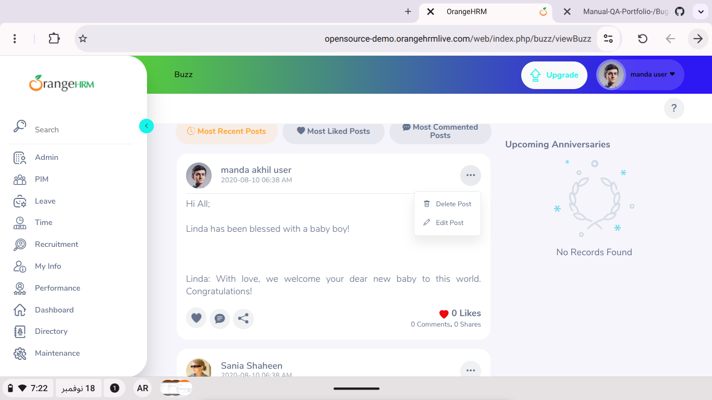

**Title:** Delete Post Option Displayed for All Users Instead of the Author Only
**Ticket ID:** BUG-003
**Project / Module:** Control Panel — Buzz Module
**Type:** Functional / Security
**Severity:** High — It is a security vulnerability that allows deleting other users' data.
**Priority:** Urgent — Defined by the site owner.
**Reproduction Rate:** 2 out of 2 attempts (100%)

**Environment:**
- Version / Build: OrangeHRM OS 5.9 (Web Version)
- Device & OS: Chromebook (ChromeOS)
- Browser: Google Chrome 150.0.7871.289 (64-bit)
- Date & Time: November 18, 2026 — 7:00 PM (Baghdad Time)

**Reference:**
Standard system access control logic (Delete and edit options should be restricted to the post owner only; deleting other users' content must not be allowed).

**Attachments:**
- `buzz-delete-post-option.png` (Full screen showing the delete and edit options displayed on another user's post)

**Steps to Reproduce:**
1. Log in with an admin account on the OpenSource environment.
2. Navigate to the Buzz module.
3. Search for a post published by another user, not yourself.
4. Click on the three dots at the top of the post.

**Actual Result:**
Edit and delete post options appear. When clicking "Delete Post", a confirmation message appears:
`Are you Sure? The selected item will be permanently deleted. Are you sure you want to continue?`

**Expected Result:**
The delete post feature should not be visible or accessible to anyone other than the post owner.

**Additional Notes:**
Tested the deletion process, and the post was successfully deleted.

**Evidence / Screenshot:**

